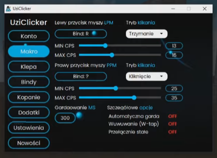
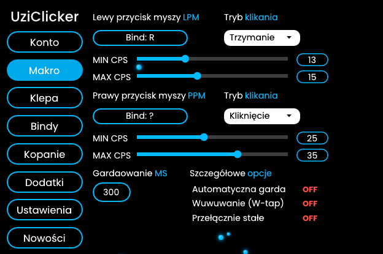
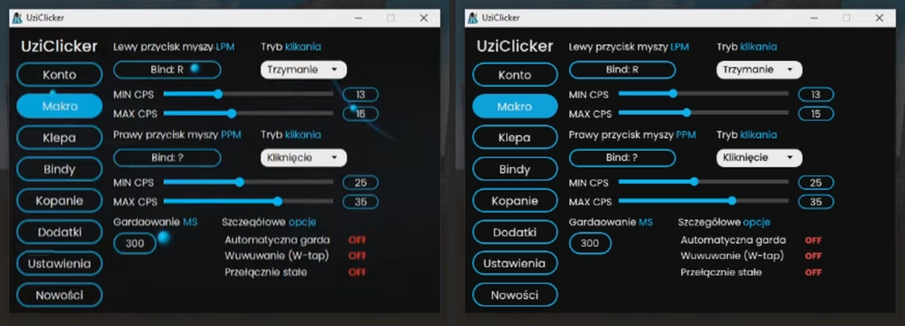
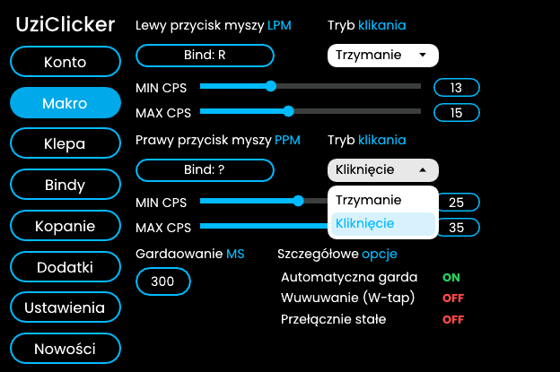

# UziClicker – GUI w Dear ImGui (1:1)

GUI ze screena odtworzone w Dear ImGui (C++17): natywne okno Windows (Win32 + DirectX 11) z paskiem zakładek po lewej i stroną **Makro**. Układ, rozmiary, font i kolory są zmierzone ze screena i sprawdzone porównaniem piksel po pikselu.

| Screen | Render |
| --- | --- |
|  |  |

Porównanie: po lewej screen, po prawej render przepuszczony przez to samo co screen (skala 2/3 i zakres kolorów wideo 16–235, patrz [Pomiary](#pomiary)). Elementy pokrywają się z dokładnością do ~1 px:



Stan po kliknięciu (rozwinięta lista, włączona opcja):



## Co działa

- **Zakładki** w pasku bocznym. Na screenie widać tylko **Makro**, pozostałe strony mają sam nagłówek i czekają na zawartość (`DrawPlaceholder()` w `src/uzi/menu.cpp`).
- **Bind**: kliknij i naciśnij klawisz (klawiatura albo boczne/środkowy przycisk myszy). `Esc` / `Backspace` czyści bind (`Bind: ?`), klik obok anuluje.
- **Tryb klikania**: lista `Trzymanie` / `Kliknięcie`.
- **MIN / MAX CPS**: suwak (przeciąganie albo kółko myszy) i pole z wartością, w które można wpisać liczbę (Enter zatwierdza). MIN nie przekroczy MAX i odwrotnie. Zakres LPM 5–30, PPM 5–50 (wyliczony z położenia suwaków na screenie).
- **Gardaowanie MS**: pole liczbowe 0–9999.
- **Szczegółowe opcje**: klik w wiersz przełącza `OFF` / `ON`.
- **Świecące kropki**: na screenie są 4 kropki w kolorze akcentu w przypadkowych miejscach (nawet na przyciskach), więc są zrobione jako kilka powoli pływających kropek. Wyłączasz je przez `uzi::GetSettings().particles = false`.
- **DPI**: okno ma 624×415 przy 100%. Przy 125% / 150% całe GUI (razem z fontem) rośnie proporcjonalnie i zostaje ostre, także po przeciągnięciu okna na monitor z innym DPI.

To jest samo GUI, bez logiki klikania. Wszystkie wartości są w `uzi::GetSettings()`.

## Build

Windows (Visual Studio 2019/2022, CMake):

```
cmake -S uziclicker -B build-uzi
cmake --build build-uzi --config Release
build-uzi\Release\uziclicker.exe
```

Albo w Visual Studio: *File → Open → Folder* i wybierz katalog `uziclicker`. Build z katalogu głównego repo też działa (zbuduje przy okazji menu Impulze), exe jest wtedy w `build\uziclicker\Release\`.

Linux (GLFW + OpenGL 3, potrzebny `libglfw3-dev`):

```
cmake -S uziclicker -B build-uzi -DCMAKE_BUILD_TYPE=Release
cmake --build build-uzi -j
./build-uzi/uziclicker_glfw
```

Dear ImGui 1.91.9b jest brany z `external/imgui` (wspólny z resztą repo). Inną kopię wskażesz przez `-DUZI_IMGUI_DIR=...`.

## Użycie w swoim projekcie

Dodaj `src/uzi/*.cpp` i katalog `src` do include'ów. Źródła są w UTF-8 (polskie napisy), w MSVC potrzebna jest flaga `/utf-8` (CMake ustawia ją sam).

```cpp
#include "uzi/menu.hpp"

ImGui::CreateContext();
uzi::Setup(dpi_scale);   // fonty + styl, przed pierwszym NewFrame (1.0f = 100%)

// co klatkę:
ImGui::NewFrame();
uzi::Render();           // wypełnia całe io.DisplaySize
ImGui::Render();

// odczyt ustawień:
const uzi::Settings& s = uzi::GetSettings();
s.left.bind;             // ImGuiKey, ImGuiKey_None = brak bindu
s.left.mode;             // uzi::ClickMode::Hold ("Trzymanie") / Click ("Kliknięcie")
s.left.min_cps;          // s.left.max_cps, s.right... (PPM)
s.block_ms;              // s.auto_block, s.w_tap, s.sticky_toggle
```

Menu zajmuje całe okno, więc ma być jedyną rzeczą w swoim oknie, tak jak w `src/main_dx11.cpp`.

## Pliki

| Plik | Co zawiera |
| --- | --- |
| `src/uzi/menu.hpp`, `src/uzi/menu.cpp` | ustawienia, pasek boczny, strona Makro (`DrawMakro()`), napisy |
| `src/uzi/widgets.hpp`, `src/uzi/widgets.cpp` | widgety: przycisk zakładki, Bind, lista, suwak, pole z wartością, ON/OFF, kropki |
| `src/uzi/style.hpp` | wszystkie wymiary i kolory zmierzone ze screena |
| `src/uzi/fonts.cpp`, `src/uzi/fonts/` | wbudowany font Poppins (Regular, Medium, Bold, z polskimi znakami) |
| `src/main_dx11.cpp` | okno Win32 + DirectX 11: stały rozmiar, wyszarzony przycisk maksymalizacji jak w oryginale, DPI |
| `src/main_glfw.cpp` | to samo na GLFW + OpenGL 3 |

## Pomiary

- Screen to klatka z nagrania. Jest przeskalowana do 2/3 (przyciski paska tytułu Windows mają na nim 31 px szerokości zamiast 46) i ma kolory ściśnięte do zakresu wideo 16–235 (biały pasek tytułu ma 235, czarny tekst 16). Oba efekty są odwrócone, więc np. tło okna jest czarne, a nie `#101010` jak na screenie.
- Font: Poppins, rozpoznany i dopasowany do napisów ze screena. Regular 14,5 px (napisy), 16,75 px (zakładki), Medium 22,9 px (tytuł), Bold 13,4 px (ON / OFF).
- Zakładki 124×35 co 45,7 px, obramowanie 2 px. Bind 155×26, lista 124×26 z zaokrągleniem 10 px. Suwak: tor 246×6, gałka ⌀12,8. Pola z wartością 52×21 (obramowanie 1,5 px), pole MS 62×32.
- Kolory: niebieski `(0, 187, 255)` na obramowaniach, suwakach i wyróżnionych słowach, `(0, 169, 233)` na zaznaczonej zakładce, tor suwaka `(60, 62, 62)`, OFF `(255, 75, 70)`. Stan ON, najechanie myszą i rozwinięta lista nie są widoczne na screenie, więc są dorobione w tym samym stylu.
- Napisy są przepisane 1:1 razem z literówkami oryginału („Gardaowanie MS”, „Przełącznie stałe”). Wszystkie są w `src/uzi/menu.cpp`.
- Półprzezroczyste cyfry „35852” na screenie to znak wodny (np. ID licencji), a nie część GUI, więc nie są odtworzone. W `docs/reference.png` zostały zamazane.
- Ikona okna jest domyślna z Windows, bo oryginalnej nie kopiowałem. Własną ustawisz przez plik `.rc` i `wc.hIcon` w `main_dx11.cpp`.

## Fonty

Poppins 4.004, SIL Open Font License 1.1 (`src/uzi/fonts/LICENSE-Poppins.txt`). Okrojony do Latin, Latin-1 i Latin Extended-A (polskie znaki), skompresowany i zakodowany w base85 w tym samym formacie co `misc/fonts/binary_to_compressed_c` z Dear ImGui (ładowany przez `AddFontFromMemoryCompressedBase85TTF`).
